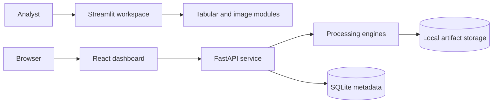

# AutoData Hub

[](https://www.python.org/)
[](https://react.dev/)
[](https://fastapi.tiangolo.com/)
[](LICENSE)

AutoData Hub is a local-first data quality and preprocessing toolkit for tabular and image datasets. It provides a Streamlit analyst workspace and a React/FastAPI job dashboard for profiling, cleaning, privacy transformations, quality comparison, and export.

> **Development status:** This project is intended for local evaluation and controlled development workflows. It does not currently provide authentication, authorization, tenant isolation, durable distributed jobs, or production deployment hardening. Bind services to loopback addresses and do not expose them to an untrusted network.

## Features

- Profile CSV, TSV, Excel, and image inputs.
- Detect common PII patterns and apply redaction, hashing, or anonymization.
- Impute missing values and identify anomalies in tabular data.
- Clean, scale, and encode tabular datasets through configurable API presets.
- Evaluate and enhance images with classical OpenCV processing.
- Optionally run locally provisioned ONNX image-restoration models.
- Compare pre-processing and post-processing quality and performance metrics.
- Export tabular data, images, reports, manifests, and generated Python pipelines.
- Keep raw, intermediate, and processed API artifacts in separate local storage paths.

## Current Scope

| Capability | Status |
| --- | --- |
| Streamlit tabular workflows | Implemented |
| Streamlit image workflows | Implemented |
| FastAPI upload and in-process jobs | Implemented for local development |
| React dashboard | Implemented for local development |
| SQLite metadata and local artifact storage | Implemented |
| Optional ONNX image restoration | Implemented with runtime and model-license caveats |
| Generated replay scripts | Partial; supported actions and CSV input only |
| Authentication and multi-user isolation | Not implemented |
| Durable or distributed job execution | Not implemented |
| Audio, speech, and video processing | Not implemented |

## Architecture

The repository contains two related applications. They share a product domain but do not yet use one unified processing engine.



## Repository Layout

| Path | Purpose |
| --- | --- |
| `app.py` | Streamlit entry point |
| `ui/` | Streamlit views and workflow tabs |
| `core/` | Ingestion, schemas, and dataset management |
| `modules/` | Privacy, imputation, anomaly, image, evaluation, and export logic |
| `backend/` | FastAPI routes, services, engines, and SQLite models |
| `frontend/` | React, Vite, and Tailwind dashboard |
| `tests/` | Python unit, integration, security, and API tests |
| `storage/` | Ignored runtime data with committed directory placeholders |
| `utils/` | Model provisioning, sandboxing, logging, and profiling utilities |

## Prerequisites

- 64-bit Python 3.11 through 3.13; Python 3.12 is recommended.
- Node.js 20.19 or newer (or 22.12 or newer) for the React dashboard.
- At least 8 GB RAM for typical local workflows.
- An NVIDIA GPU is optional and only needed for the GPU ONNX Runtime variant.

Do not install the CPU and GPU ONNX Runtime packages in the same virtual environment.

## Quick Start

### 1. Clone the repository

```bash
git clone https://github.com/Harsha-B-CSE/AutoData-Hub.git
cd AutoData-Hub
```

### 2. Create a Python environment

Windows PowerShell:

```powershell
py -3.12 -m venv .venv-cpu
.\.venv-cpu\Scripts\python.exe -m pip install --upgrade pip setuptools wheel
.\.venv-cpu\Scripts\python.exe -m pip install -r requirements-cpu.txt "scikit-learn==1.7.1"
.\.venv-cpu\Scripts\python.exe -m pip check
```

Linux or macOS:

```bash
python3 -m venv .venv-cpu
./.venv-cpu/bin/python -m pip install --upgrade pip setuptools wheel
./.venv-cpu/bin/python -m pip install -r requirements-cpu.txt
./.venv-cpu/bin/python -m pip check
```

For a compatible NVIDIA environment, create a separate virtual environment and install `requirements-gpu.txt` instead.

### 3. Configure the API

Windows PowerShell:

```powershell
if (-not (Test-Path .env)) { Copy-Item .env.example .env }
```

Linux or macOS:

```bash
test -f .env || cp .env.example .env
```

Local environment files are ignored by Git. Never commit API keys, database credentials, or other secrets.

### 4. Run the Streamlit workspace

Windows PowerShell:

```powershell
.\.venv-cpu\Scripts\python.exe -m streamlit run app.py --server.address 127.0.0.1 --server.port 8501
```

Linux or macOS:

```bash
./.venv-cpu/bin/python -m streamlit run app.py --server.address 127.0.0.1 --server.port 8501
```

Open `http://127.0.0.1:8501`.

### 5. Run FastAPI and React

Start FastAPI in one terminal:

```powershell
.\.venv-cpu\Scripts\python.exe -m uvicorn backend.main:app --env-file .env --host 127.0.0.1 --port 8000
```

Install and start React in another terminal:

```powershell
npm.cmd --prefix .\frontend ci
$env:NODE_OPTIONS = "--dns-result-order=ipv4first"
npm.cmd --prefix .\frontend run dev -- --host 127.0.0.1
```

Open:

- React dashboard: `http://127.0.0.1:3000`
- Swagger UI: `http://127.0.0.1:8000/docs`
- ReDoc: `http://127.0.0.1:8000/redoc`

Equivalent Linux or macOS commands can use `./.venv-cpu/bin/python` and `npm --prefix ./frontend`.

## API Overview

The running OpenAPI document at `/openapi.json` is the authoritative API contract.

| Method | Endpoint | Purpose |
| --- | --- | --- |
| `GET` | `/api/v1/health` | Service health and resource limits |
| `POST` | `/api/v1/upload` | Upload and classify a dataset |
| `GET` | `/api/v1/datasets` | List uploaded datasets |
| `GET` | `/api/v1/datasets/{id}/preview` | Preview tabular rows or image metadata |
| `GET` | `/api/v1/config/presets` | List processing presets |
| `POST` | `/api/v1/process` | Dispatch an in-process job |
| `GET` | `/api/v1/jobs/{id}` | Read job status and progress |
| `GET` | `/api/v1/jobs/{id}/quality` | Read quality results |
| `GET` | `/api/v1/jobs/{id}/diff` | Compare source and processed output |
| `GET` | `/api/v1/jobs/{id}/export` | Export a completed job |

## Configuration

The API reads these environment variables:

| Variable | Default | Purpose |
| --- | --- | --- |
| `ENVIRONMENT` | `development` | Environment label |
| `DEBUG` | `True` | Development reload behavior |
| `API_HOST` | `127.0.0.1` | API bind address |
| `API_PORT` | `8000` | API port |
| `STORAGE_BASE_DIR` | `./storage` | Runtime artifacts and SQLite location |
| `MAX_UPLOAD_SIZE_BYTES` | `1073741824` | Upload size ceiling |
| `MAX_ZIP_EXTRACT_SIZE_BYTES` | `2147483648` | Aggregate ZIP extraction ceiling |
| `MAX_WORKER_PROCESSES` | Core-derived, max 3 | Local process worker cap |
| `DEFAULT_CHUNK_SIZE` | `5000` | Default processing chunk size |

## Optional Image Models

Model weights are intentionally excluded from Git. Provision the default model set locally with:

```powershell
.\.venv-cpu\Scripts\python.exe -m utils.setup_vision_models
```

Run `python -m utils.setup_vision_models --help` for selection and destination options. Review every third-party model's license before download or deployment; some experimental entries are non-commercial.

## Testing

Run the Python suite against isolated temporary storage.

Windows PowerShell:

```powershell
$env:STORAGE_BASE_DIR = Join-Path $env:TEMP "autodata-hub-pytest-$([guid]::NewGuid())"
$env:PYTHONDONTWRITEBYTECODE = "1"
.\.venv-cpu\Scripts\python.exe -m pytest .\tests -q -p no:cacheprovider
```

Linux or macOS:

```bash
export STORAGE_BASE_DIR="$(mktemp -d)"
export PYTHONDONTWRITEBYTECODE=1
./.venv-cpu/bin/python -m pytest ./tests -q -p no:cacheprovider
```

Validate the frontend production bundle with:

```powershell
npm.cmd --prefix .\frontend ci
npm.cmd --prefix .\frontend run build
```

## Security Notes

- Run the application on `127.0.0.1`; it has no authentication or authorization boundary.
- Treat uploaded files, generated reports, local SQLite data, and exported artifacts as sensitive.
- Keep `.env` files, runtime storage, generated output, model weights, and virtual environments out of Git.
- Review archive handling, CORS, error responses, and object-level authorization before any network deployment.
- Perform dependency, secret, and static analysis before a production release.

## Known Limitations

- The Streamlit and React/FastAPI applications use separate processing implementations.
- FastAPI jobs run in the API process and are not restart-safe or distributed.
- SQLite and local files are designed for a single development host.
- Legacy `.xls` handling in the Streamlit path is unreliable; prefer `.xlsx` or CSV.
- Optional model quality, hardware support, and licensing vary by model.
- Docker files are included for development work, but the full Compose path is not a verified quick start.
- There are no frontend automated tests or CI workflows in the current repository.

## Contributing

1. Create a focused branch from `main`.
2. Add or update tests for behavioral changes.
3. Run the Python suite and frontend production build.
4. Open a pull request that explains the change, validation, and any security or data-handling impact.

## License

Licensed under the [Apache License 2.0](LICENSE).
